<h1 align="center">Air–Ground Cooperative Path Planning for a UAV–UGV Team</h1>

<p align="center">
  <b>A drone scouts the terrain, a ground robot decides where it can safely drive, and both follow the same path.</b><br>
  Embedded, on-board, over Wi-Fi — Raspberry Pi + PX4 on the drone, Jetson Xavier NX on the ground robot.
</p>

<p align="center">
  
  
  
  
  
</p>

<p align="center">
  <b>Authors:</b> Akileshguhan A · Karthikeyan M · Karthik J<br>
  School of Computer Science and Engineering, Vellore Institute of Technology, Chennai
</p>

<p align="center">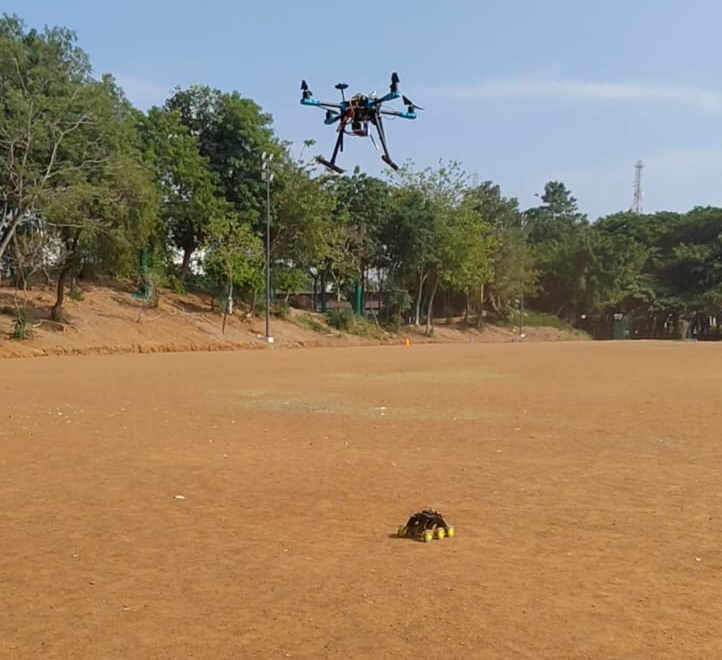</p>
<p align="center"><sub>First outdoor run: the drone flies its waypoint mission while the UGV follows the same path on the ground.</sub></p>

---

## Contents

1. [Abstract](#abstract)
2. [Motivation](#motivation)
3. [Contributions](#contributions)
4. [System overview](#system-overview)
5. [Hardware](#hardware)
6. [Terrain-aware planner (ugvnav)](#terrain-aware-planner-ugvnav)
7. [Drone and UGV control](#drone-and-ugv-control)
8. [Pi–Jetson communication link](#pijetson-communication-link)
9. [The cooperative loop](#the-cooperative-loop)
10. [Results](#results)
11. [Discussion](#discussion)
12. [Limitations and future work](#limitations-and-future-work)
13. [Repository structure](#repository-structure)
14. [Authors](#authors)
15. [Citation](#citation)

---

## Abstract

Ground robots perceive only a short distance ahead, so obstacles, steps and steep slopes beyond their sensors are found late. This project builds an air–ground team in which an unmanned aerial vehicle (UAV) scans the terrain and an unmanned ground vehicle (UGV) turns that scan into a path that is safe for itself, which both vehicles then follow.

On the UGV's Jetson, a planning package (`ugvnav`) converts the point cloud into a heightmap, builds a graph of stations and lanes along the drone's flight line, extracts terrain features with principal component analysis (PCA), gates every segment against the UGV's capability model, and runs A* to the farthest reachable station. The two computers exchange clouds and paths over a purpose-built Wi-Fi TCP protocol.

The live planning loop averages **0.71 s per cycle**. Two feature-estimation changes cut false rejections from **16 to 0**, and a synthetic D455 comparison shows **no false acceptances and no false rejections** in the normal configuration. The full plan–fly–drive loop, including aborts, is verified in simulation, and a first outdoor run of both vehicles has been carried out.

## Motivation

| | Strength | Weakness |
|---|---|---|
| **UGV** | Carries loads, runs for long periods | Sees only what is close to the ground; hazards are found late |
| **UAV** | Wide view of the terrain from above | Short endurance, little payload |

Pairing the two lets the drone act as a **scout** that maps the ground before the UGV reaches it. Three constraints shaped the design:

- **Embedded only.** Everything runs on a Raspberry Pi and a Jetson Xavier NX.
- **No trained model.** There is no terrain-classification network for this task, and sparse-convolution libraries have no ARM builds, so the planner uses geometric features.
- **Wi-Fi bandwidth.** The link limits how much sensor data can move per cycle, so the data format matters.

## Contributions

- **Terrain-aware planner.** Point cloud → heightmap → station-and-lane graph → PCA slope and step-height features → graduated gating against a private UGV capability model → A*.
- **Two feature decisions that remove systematic errors.** Slope is measured only on planar patches, and step height is the spread of residuals around a local plane fit.
- **Reliable Pi–Jetson protocol.** Heartbeats, SHA-256 integrity checks, acknowledgements and atomic file writes, plus a measured data budget for what to send.
- **Complete plan–fly–drive loop.** A PX4 OFFBOARD waypoint mission with safety limits and an IMU-guided UGV driver, with abort paths when the drone fails or the link drops.

## System overview

<p align="center">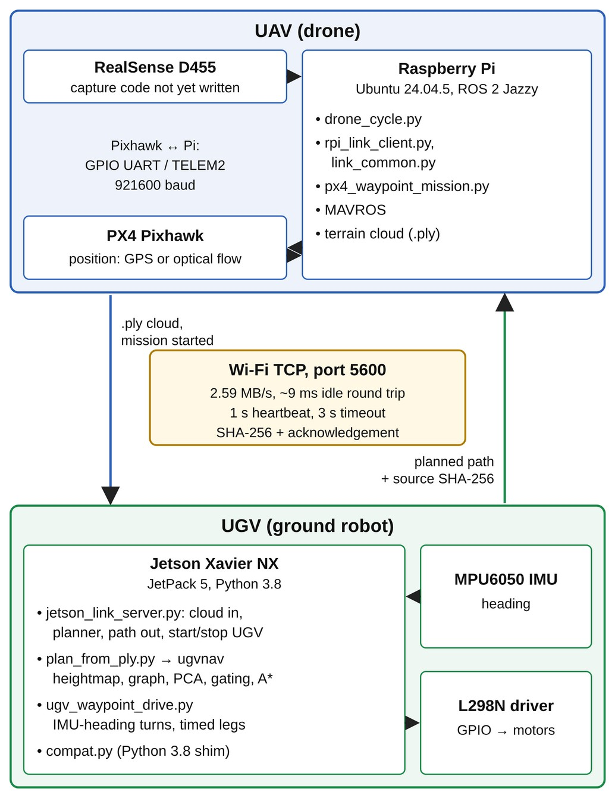</p>
<p align="center"><sub>The drone (top) and the UGV (bottom), connected by a Wi-Fi TCP link.</sub></p>

The drone sends a terrain point cloud. The Jetson plans and returns a path written along the planned corridor (x forward, y left). Each vehicle then follows that path relative to its own start point.

## Hardware

| Part | Drone (UAV) | Ground robot (UGV) |
|---|---|---|
| Computer | Raspberry Pi 4 — Ubuntu 24.04, ROS 2 Jazzy | Jetson Xavier NX — JetPack 5, Python 3.8 |
| Control | PX4 Pixhawk over MAVROS (TELEM2 UART) | L298N motor driver on the Jetson's GPIO |
| Sensing | Intel RealSense D455 depth camera | MPU6050 IMU for heading (no wheel encoders) |
| Link | Wi-Fi TCP from the Pi to the Jetson | |

<p align="center">
  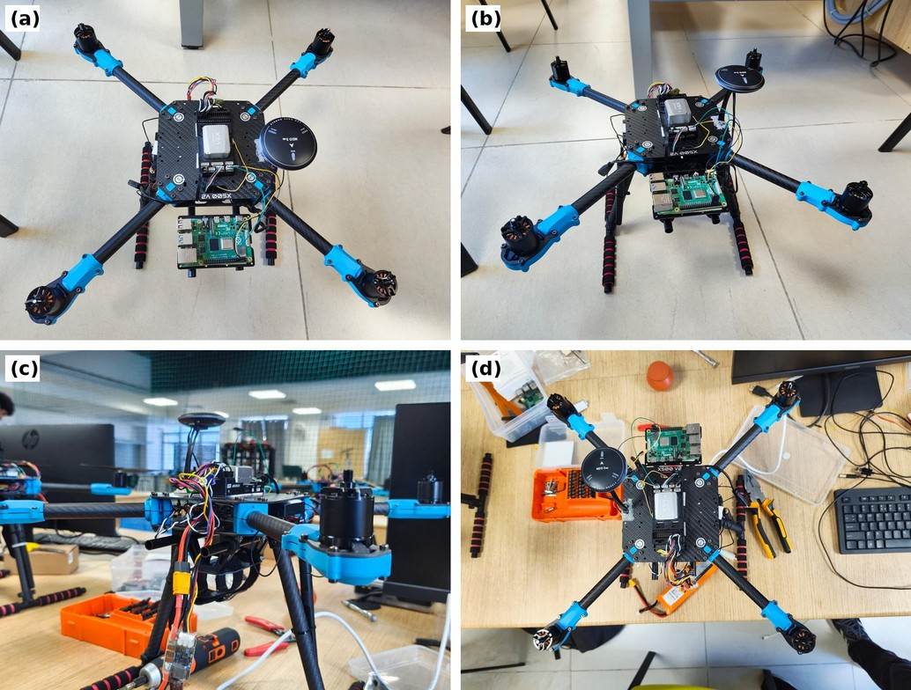
  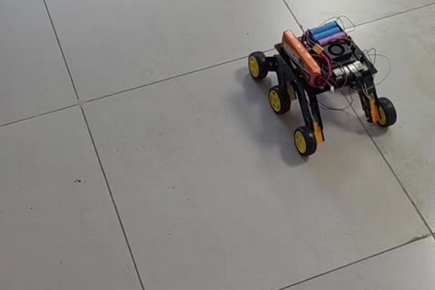
</p>

## Terrain-aware planner (ugvnav)

<p align="center">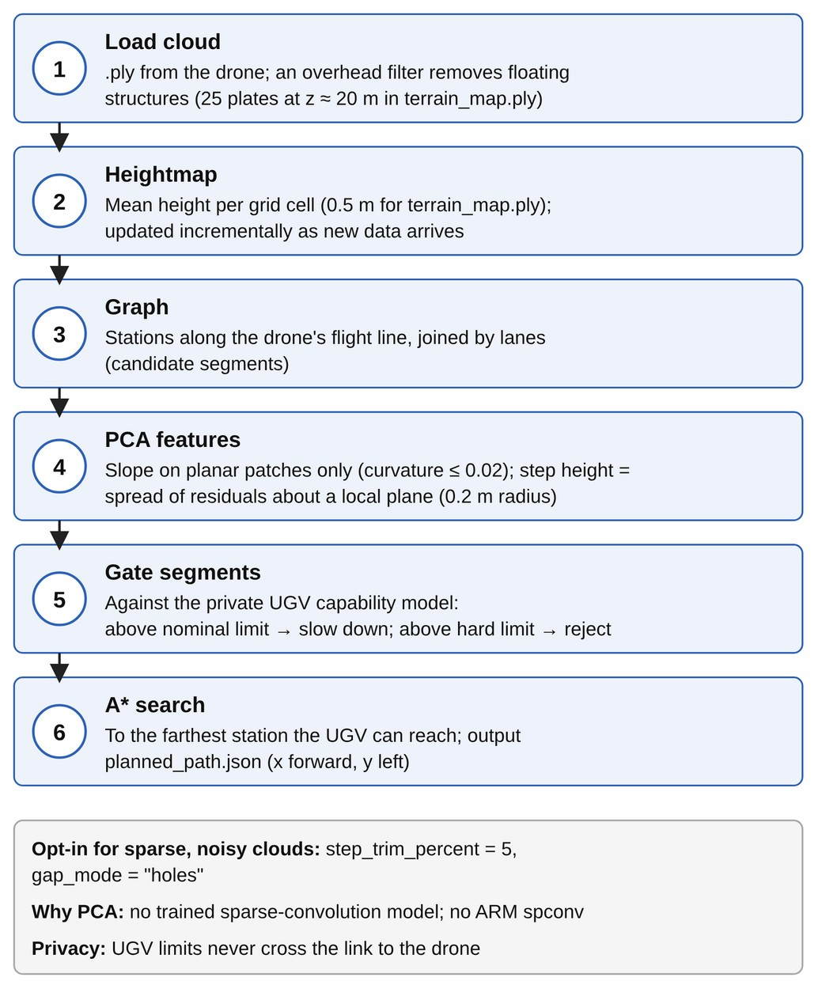</p>

| Stage | What it does |
|---|---|
| **1. Load** | Reads the cloud from the drone; an overhead filter removes floating structures. |
| **2. Heightmap** | Bins points into a grid, storing the mean height per cell; can be updated incrementally. |
| **3. Graph** | Places stations along the flight line, joined by lanes: the candidate segments. |
| **4. PCA features** | Measures slope on planar patches only, and step height from plane-fit residuals. |
| **5. Gating** | Compares each segment with the UGV's capability model — slow down, or reject. |
| **6. A\*** | Searches the gated graph for a path to the farthest reachable station. |

**Graduated gating.** A feature above the *nominal* limit keeps the segment but slows the UGV; above the *hard* limit the segment is rejected. The limits live only in the UGV's evaluator and never cross the link.

<p align="center">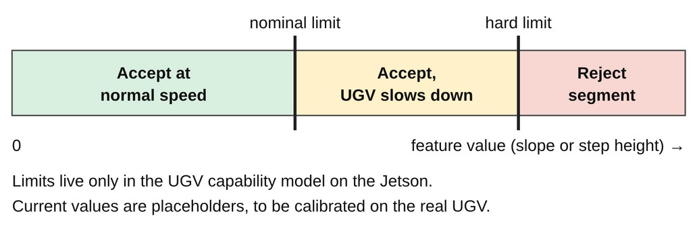</p>

### Planner output on a test terrain

A synthetic D455 capture of a terrain with known geometry: flat ground, a 12° ramp, a 0.08 m step and a 1.2 m deep trench that blocks two of the three lanes.

<table>
<tr>
<td width="50%">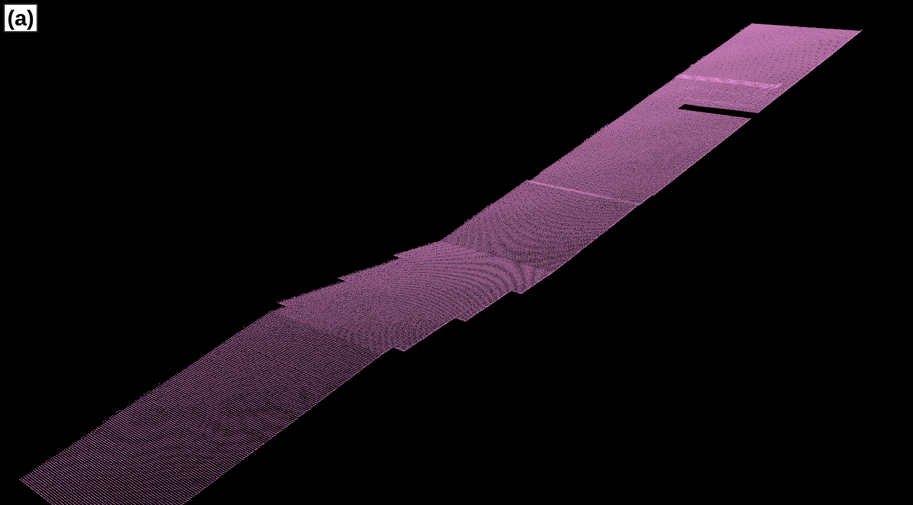<br><sub><b>Input</b> — cloud after loading and heightmap downsampling; the trench appears as a gap.</sub></td>
<td width="50%">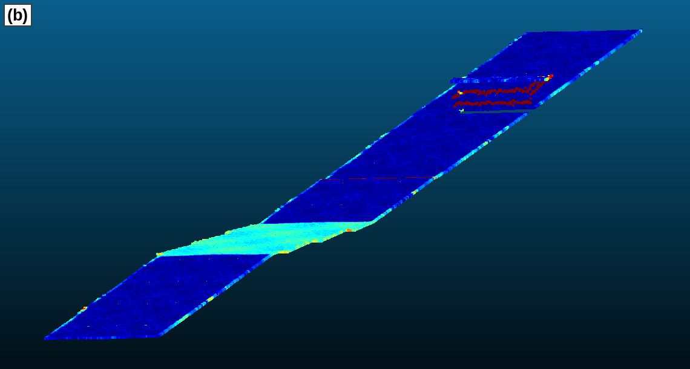<br><sub><b>PCA slope</b> — 0° (blue) to 30° (red): flat ground blue, ramp cyan, step and trench edges red.</sub></td>
</tr>
<tr>
<td>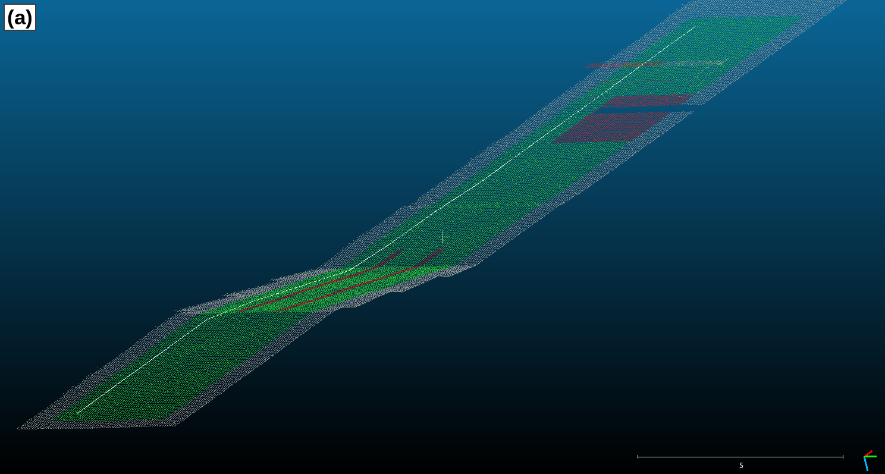<br><sub><b>Gating</b> — feasible segments green, rejected red; the selected route is the white line.</sub></td>
<td>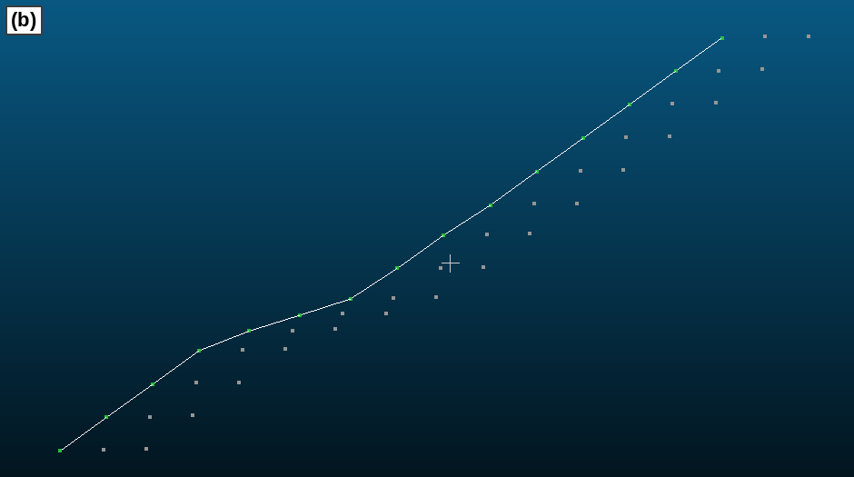<br><sub><b>Graph and A*</b> — stations 2 m apart in three lanes 1.2 m apart; the route changes lane around the trench.</sub></td>
</tr>
</table>

## Drone and UGV control

**Drone.** A ROS 2 node commands PX4 in OFFBOARD mode through MAVROS. Waypoints are relative to the takeoff point, and the drone holds a chosen speed and altitude.

| Condition | Behaviour |
|---|---|
| Plan goes beyond 15 m from takeoff or 5 m altitude | Plan is refused |
| Pilot changes flight mode | Script hands over control |
| Position lost or vehicle disarms | Switch to AUTO.LAND |
| No position estimate (GPS or optical flow) | Vehicle will not arm |

**UGV.** Without wheel encoders, distance comes from time. For each leg the UGV turns in place to the target heading using the IMU, then drives straight for leg length ÷ calibrated speed. Turn control uses a stall boost, braking with a momentum lead, settle checks and small nudge pulses. Collinear waypoints are merged into one segment.

<p align="center">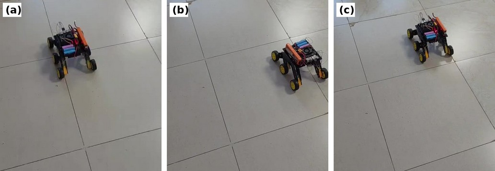</p>
<p align="center"><sub>Indoor UGV driving test at t = 0 s, 5 s and 15 s.</sub></p>

## Pi–Jetson communication link

MAVROS only reaches the Pixhawk, and its serial link tops out at about 0.09 MB/s, so the boards use their own TCP protocol over Wi-Fi.

<p align="center">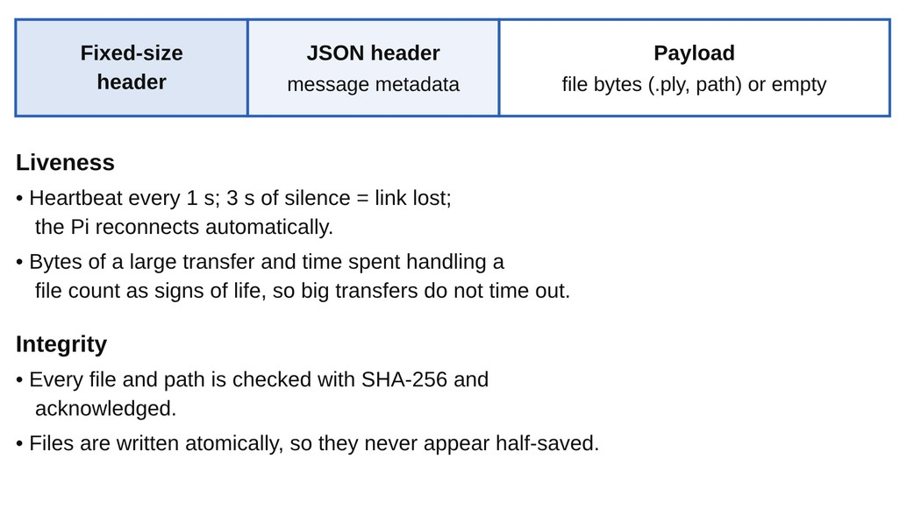</p>

- **Liveness.** A heartbeat every second; 3 s of silence means the link is lost, and the Pi reconnects on its own. Large transfers count as signs of life.
- **Integrity.** Every file and path is checked with SHA-256 and acknowledged, and files are written atomically.
- **Freshness.** The Pi accepts only a path planned from its own latest upload, matched by hash.

## The cooperative loop

<p align="center">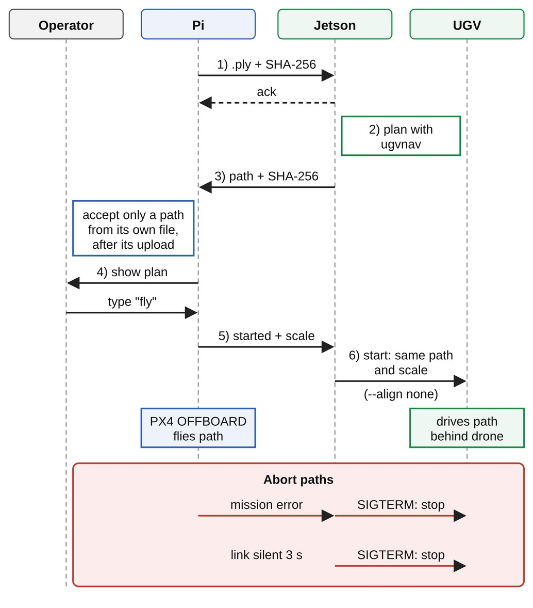</p>

1. The Pi sends the cloud to the Jetson.
2. The Jetson plans and sends back the path.
3. The Pi checks the path matches its own upload and shows the plan.
4. The operator confirms; the drone takes off and flies the path.
5. The Jetson starts the UGV on the same path at the same scale.
6. If the drone mission fails or the link drops mid-mission, the Jetson stops the UGV.

## Results

### Planning cycle time

<table>
<tr>
<td width="50%">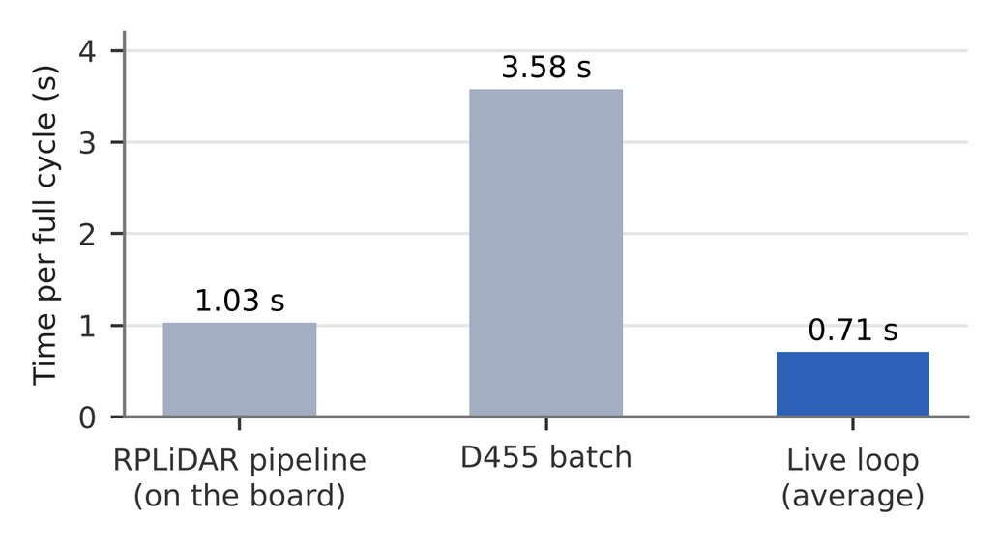</td>
<td>

| Configuration | Time per cycle |
|---|---|
| RPLiDAR pipeline (on board) | 1.03 s |
| D455 batch | 3.58 s |
| **Live loop** | **0.71 s** (avg.) |

</td>
</tr>
</table>

### Accuracy of terrain gating

- Measuring slope only on planar patches stopped step edges from reading as **34° inclines**.
- Taking step height from plane-fit residuals reduced false rejections from **16 to 0**.
- On the synthetic D455 comparison, the normal configuration made **0 false acceptances and 0 false rejections**; only the deliberately noisy raw-cloud test failed (86 false rejections).

<p align="center">
  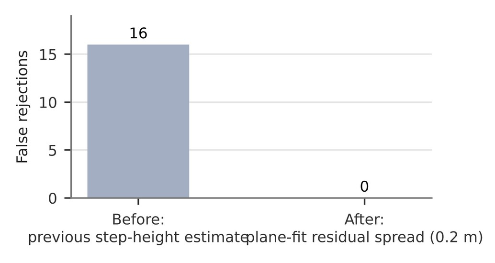
  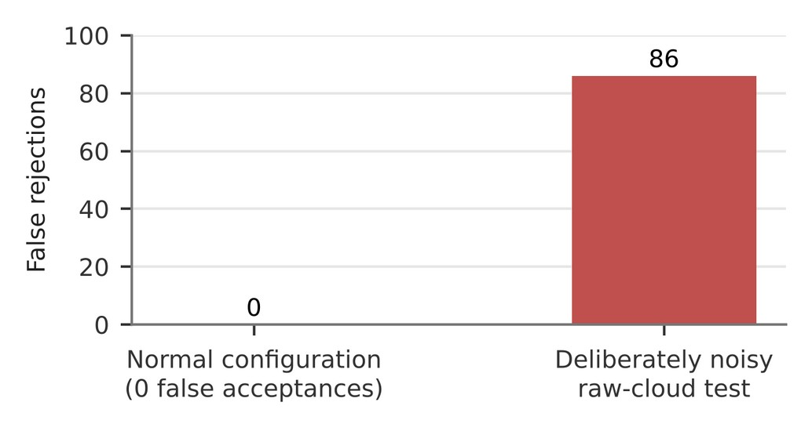
</p>

### Real terrain

On a real 8.3-million-point terrain cloud with 0.5 m cells, the route follows feasible segments through the near half of a known-flat test corridor and stops where sparse points cause false rejections in the far half.

<p align="center">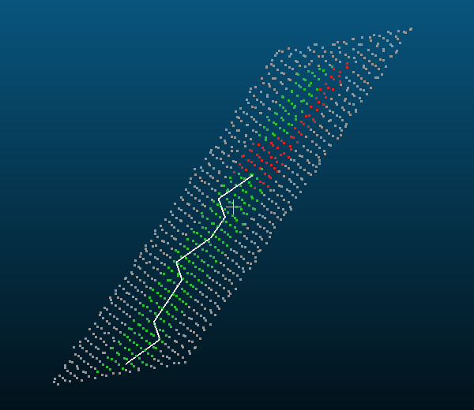</p>

### Communication link and data budget

| Payload | Size | Transfer time at 2.59 MB/s |
|---|---|---|
| Raw D455 point cloud | ~41 MB | ~16 s |
| **Heightmap** | **~0.72 MB** | **~0.28 s** |

The Wi-Fi link measured **2.59 MB/s** with about **9 ms** round trip, roughly **29×** the MAVROS serial link. Sending heightmaps instead of raw clouds keeps the transfer well under one planning cycle.

<p align="center">
  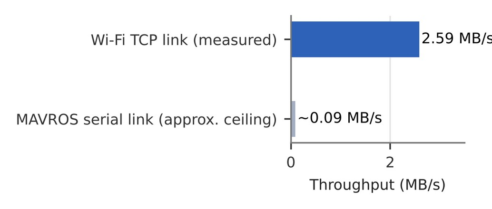
  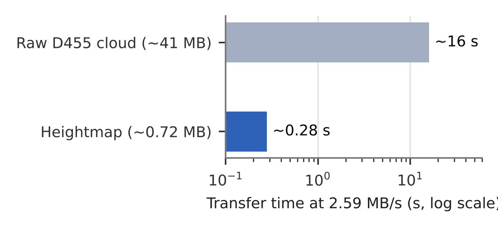
</p>

### Full-loop verification

| Scenario (simulation: mock PX4, UGV dry run) | Outcome |
|---|---|
| Normal run | Drone and UGV end at the same point |
| Obstacle in the corridor | Planner produces a detour |
| Old paths | Ignored |
| Planning failure | Reported to the drone |
| Drone abort | UGV stopped within 1 ms |
| Link dies mid-flight | UGV stopped |

The loop has since been run outdoors on the boards: the drone flew its mission autonomously while the UGV drove the same path (photo at the top).

## Discussion

- **Geometric features are enough on embedded hardware.** Without a trained model, PCA features gave a planner that runs in under a second on the Jetson with no errors on the synthetic comparison.
- **Where features are measured matters as much as which features are used.** Restricting slope to planar patches and step height to plane-fit residuals separates real hazards from step edges and general unevenness.
- **Send less, not faster.** At 2.59 MB/s, a raw cloud takes about 16 s; a heightmap takes about 0.28 s.
- **Safety in every layer.** Flight limits, pilot override, link-loss detection, hash-matched paths, and a UGV that stops whenever the drone or the link fails.

## Limitations and future work

| Open item | Next step |
|---|---|
| Full loop tested in simulation and one outdoor run | Full field trials on a dedicated router or hotspot |
| RealSense capture not written yet | Capture at each waypoint, attach poses, send heightmaps |
| No shared localisation | Common map for both vehicles; align clouds across cycles (ICP) |
| UGV limits are placeholders | Calibrate nominal and hard limits on the real UGV |
| False rejections where points are sparse | Density-aware thresholds |
| UGV distance estimated from time | Wheel encoders and a restored motor watchdog |
| UGV (0.667 m/s) faster than drone (0.5 m/s) | Explicit speed matching instead of a start delay |

<p align="center">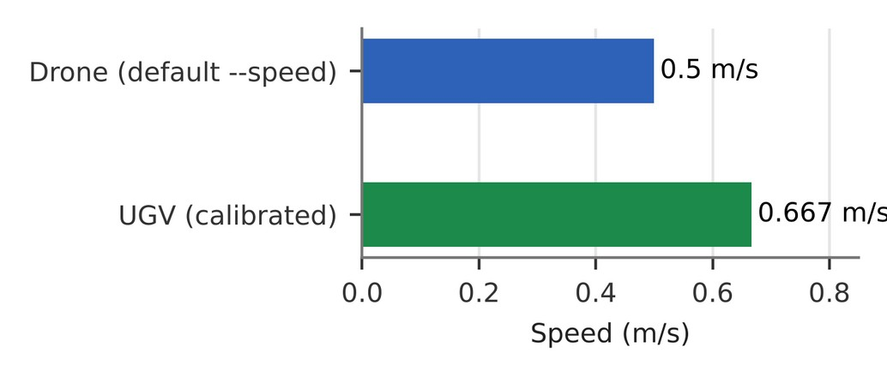</p>

## Repository structure

```
.
├── jetson/                  # UGV side (Jetson Xavier NX)
│   ├── ugv-nav/ugvnav/      # planner: heightmap, graph, PCA features, gating, A*
│   ├── ugv-nav/scripts/     # plan_from_ply, synthetic terrain, evaluation runs
│   ├── link/                # Pi–Jetson TCP link server
│   ├── ugv_drive/           # IMU-guided UGV waypoint driver and motor tests
│   └── run_jetson.sh        # starts the UGV side of the loop
├── pi/                      # Drone side (Raspberry Pi + PX4)
│   ├── rpi_link_client.py   # link client
│   ├── drone_cycle.py       # send cloud → receive path → fly
│   ├── px4_waypoint_mission.py
│   └── run_pi.sh            # starts the drone side of the loop
└── docs/images/             # figures used in this README
```

Recommended bring-up order: link test → drone dry run → UGV dry run → propellers-off run → outdoor run.

> **Safety:** always test with propellers off first, fly in an open area, and keep a pilot ready to take manual control.

## Authors

- **Akileshguhan A**
- **Karthikeyan M**
- **Karthik J**

## Citation

```bibtex
@techreport{airground2026,
  title       = {Air--Ground Cooperative Path Planning for a UAV--UGV Team},
  author      = {Karthikeyan M and Akileshguhan A and Karthik J},
  institution = {School of Computer Science and Engineering, Vellore Institute of Technology, Chennai},
  year        = {2026}
}
```

## License

Released under the MIT License — see [`LICENSE`](LICENSE).
